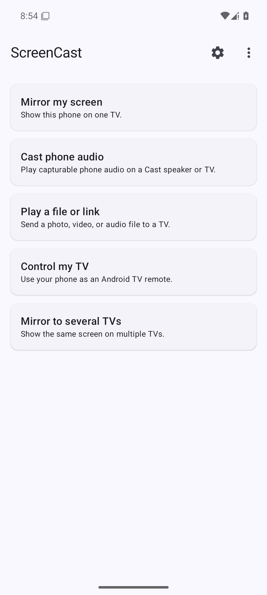
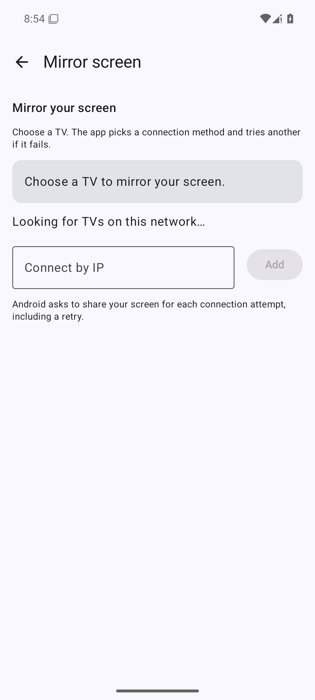
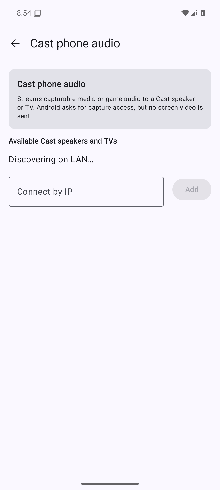
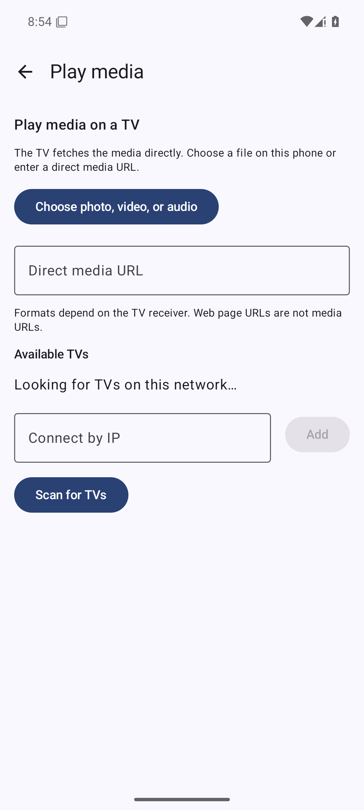
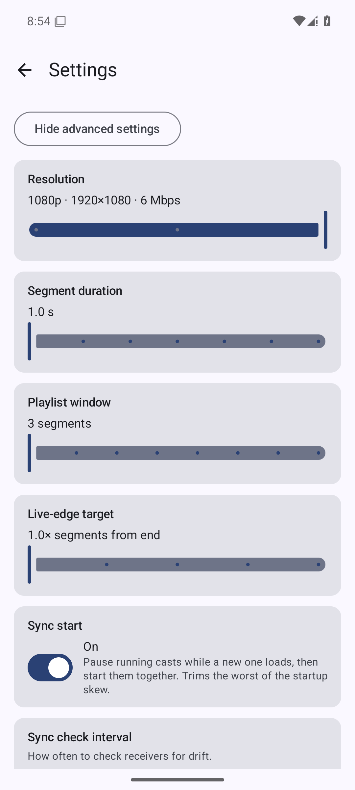

# ScreenCast

An open-source Android app that casts the phone's screen to one or more Chromecast devices over the local Wi-Fi network, with synchronized playback across all connected receivers. Also doubles as a remote control for Android TV / Google TV devices over the polo + Android TV Remote v2 protocols. Vibe-coded and unchecked.

## Screenshots

<p>
  
  
  
  
  
</p>

Captured on an Android 15 emulator with no TV on its network.

## Choose what you want to do

The home screen offers **Mirror my screen**, **Cast phone audio**, **Play a file
or link**, **Control my TV**, and **Mirror to several TVs**. For one-TV mirroring, the app tries stock
Cast Streaming first, then its WebRTC receiver if configured, then HLS. A
connection failure advances to the next method; cancelling screen-sharing
consent ends the attempt. Android asks for fresh screen-sharing consent on each
retry. On Android 14+, each TV offers **Whole screen** and **One app** capture.
If the app falls back to HLS, it shows the higher delay in the mirroring status.
The **Mirror to several TVs** button uses HLS, which can share one capture
across up to four receivers.

Media playback shows each TV once even when it advertises both Cast and DLNA.
It tries Cast first and switches to DLNA if the Cast connection fails. The
**Advanced modes** menu keeps direct HLS, Native, WebRTC, Media, and Remote
selection available, and technical settings are behind **Show advanced
settings** in Settings.

## How it works

- **Discovery**: `NsdManager` finds Chromecasts via mDNS (`_googlecast._tcp.local`).
- **Control channel**: TLS socket to Chromecast port 8009, Cast V2 protocol implemented in pure Kotlin (connection / heartbeat / receiver / media namespaces). Before sending a launch or stream key, the app authenticates the ephemeral TLS certificate with a signed Cast device-auth challenge against the [Google Cast and Eureka trust anchors published by Chromium](https://chromium.googlesource.com/chromium/src/+/refs/heads/main/components/media_router/common/providers/cast/certificate/cast_trust_store.cc). The bundled public certificates are in `app/src/main/assets/cast/`.
- **Capture**: Android `MediaProjection` + `MediaCodec` (H.264), optional audio via `AudioPlaybackCapture`.
- **HLS transport**: Used for several TVs and as a one-TV fallback. HLS is served from an embedded Ktor HTTP server on the phone. The server binds only to the Wi-Fi interface IP on a freshly-picked ephemeral port (not `0.0.0.0:8080`), so it isn't reachable over cellular or any other interface. The playlist lives under a path gated by a 128-bit random token (e.g. `http://<phone-ip>:<port>/c/<token>/stream.m3u8`); the token is generated fresh per cast session and is only valid while the foreground service is running. The Chromecast loads that URL through the Default Media Receiver (App ID `CC1AD845`). Expect ~5–10 s of latency.
- **Multi-device casting**: Up to 4 Chromecasts can subscribe to the same HLS stream in parallel. Each has its own Cast V2 session, transport controls, and volume. The capture pipeline is started once on the first device and reused for the rest, so adding a second receiver doesn't retrigger the MediaProjection consent dialog.
- **Sync across receivers**: HLS LIVE doesn't give receivers a shared clock, so by default each one picks its own live-edge and they drift. With **Sync start** enabled (Settings → Show advanced settings), the app coordinates a pause → seek → play handshake whenever a new device joins so every receiver lands on the same stream offset. A background loop then re-aligns every ~15 s: it polls `currentTime` on every session, pauses them all, seeks to the laggard's offset, and plays them back in parallel. This is best-effort — receiver-local offsets are only comparable while sessions stay connected.


## Native Cast mirroring

Choose **Mirror my screen** to try this path first on a stock Cast receiver, or
select **Native** directly from Advanced modes.
This mode launches the stock Android mirroring receiver (`674A0243`, with the
default Cast Streaming receiver `0F5096E8` as a fallback), negotiates a
Cast Streaming `OFFER`/`ANSWER`, and sends H.264 video and Opus playback audio
as encrypted Cast RTP over UDP. Both streams share one UDP socket. The app
handles RTCP sender reports, acknowledgements, retransmissions, and keyframe
requests. It paces video packets, gives audio slots during large video frames,
and adjusts the H.264 bitrate from acknowledgement progress, loss, and frames
stalled in transit. The offer includes separate video profiles from 360p30
through 1080p60 where the phone encoder supports them. The receiver chooses a
profile, then its reported dimensions, pixel rate, frame rate, bitrate, and
delay further limit the capture. The encoder and rate controller stay within
that negotiated bitrate ceiling. Sustained low throughput reduces capture
resolution or frame rate within the accepted offer; sustained recovery raises
it again. The app resizes the existing virtual display so it does not ask for
another screen-sharing grant during those quality changes. When unacknowledged video spans more than the receiver's
playout delay budget, it pauses the virtual display before further frames are
encoded. It resumes capture once acknowledgements catch up and requests a new
keyframe. If a paused receiver stops making progress, automatic mirroring moves
to the next available mode. When its video queue overflows, it waits for a
keyframe so it does not send frames that depend on a locally dropped frame. It skips
retransmissions older than the receiver's target delay plus 250 ms. It uses
neither the HLS playlist nor the custom WebRTC receiver. It casts to one device
at a time. Playback audio capture requires Android 10+ and
the audio permission. A bundled libopus encoder produces 10 ms audio packets.
If audio capture is unavailable or the receiver declines it, the app sends video
only. Android's playback capture rules limit which apps' sound can be captured.
Once a receiver acknowledges captured audio, the app sets the phone's media
volume to zero to prevent duplicate playback. It restores the prior level when
casting stops, unless the user changed the phone's media volume in the meantime.
This changes the phone's media volume for all apps; Android's playback capture
does not reroute their audio output. If audio capture is unavailable, the app
leaves phone volume unchanged.
The requested playout delay is 200 ms or less when the receiver requires it;
actual glass-to-glass latency depends on the device and network and has not
been measured for this build. The earlier audio and video sender was tested
against a stock MiTV-MOEU0 receiver; device authentication, the multi-profile
offer, and adaptive flow control still need a TV regression test. Receiver
certificate revocation lists are not checked, matching Open Screen's optional
CRL policy. Android cannot capture protected content or audio from apps that
disallow playback capture, and ordinary apps cannot appear in the system Cast
tile on GrapheneOS.
The bundled [Opus 1.5.2 source](app/src/main/cpp/opus) is licensed under its
[BSD license](app/src/main/cpp/opus/COPYING).

## Cast phone audio

Choose **Cast phone audio** to stream capturable media or game audio to a Cast
speaker or TV without sending screen video. This launches the stock Cast
Streaming audio-only receiver (`85CDB22F`), negotiates one Opus audio stream,
and sends encrypted Cast RTP over UDP. Android still asks for MediaProjection
and audio permission to capture other apps' playback. Apps that block playback
capture cannot be streamed. The phone's media volume is silenced once the
receiver acknowledges the stream and restored on stop, subject to any volume
change the user makes while casting.

## Media playback on a TV

Choose **Play a file or link** to play a photo, video, or audio file on one TV.
Select a file with Android's document picker or enter a direct HTTP(S) media
URL, then tap a TV. A web page URL will not work; the receiver must
be able to fetch and decode the media itself. This mode does not mirror the
phone screen or transcode files.

- **Google Cast:** uses the stock Default Media Receiver and sends a buffered
  media `LOAD` over Cast V2. Cast targets are discovered by mDNS, or can be
  entered by IP address. Playback status follows receiver media messages.
- **DLNA / UPnP:** discovers MediaRenderer devices with SSDP and controls their
  AVTransport service with `SetAVTransportURI`, `Play`, `Pause`, and `Stop`.
  If discovery misses a renderer, enter its device description URL. A
  successful control response only confirms that playback was requested; the
  receiver may still reject the file format.
- **Files on the phone:** the app temporarily serves the chosen document from
  the phone's Wi-Fi address through a random URL, including HTTP byte ranges.
  The file is available while the media foreground service is active. Both
  devices must be able to reach each other on the local network.

## WebRTC mode (low-latency) — optional

HLS over HTTP has ~5–10 s of latency. A separate **WebRTC** path ships alongside it for sub-second latency. One-TV automatic mirroring tries WebRTC after a failed stock Cast Streaming connection, or you can select it directly from Advanced modes.

WebRTC mode uses a **custom Cast receiver**. The app ships with a default App ID (`9098830C`) pointing at the project's hosted receiver, so it works out of the box. If you'd rather host your own receiver, register its URL at <https://cast.google.com/publish/> and paste the resulting 8-character App ID into Settings → Show advanced settings. Static receiver page + instructions live in [`receiver/`](receiver/). When you start a cast the app launches the receiver, negotiates a `RTCPeerConnection` over the Cast channel, and streams the screen directly. No HLS server, no drift/sync coordination, no multi-device fan-out.

Tradeoffs versus HLS mode:

- One Chromecast per cast (no parallel receivers).
- No pause/play/seek, no volume UI (WebRTC has no concept of media transport).
- The WebRTC Android library is a pre-built open-source AAR from [webrtc-sdk/android](https://github.com/webrtc-sdk/android) (BSD-3). Adds ~18 MB of native code across 4 ABIs. Building it from Chromium source ourselves is listed as a future decision in `CLAUDE.md`.

## Remote control mode

Choose **Control my TV** to use the app as a remote for an Android TV / Google TV — the same role the Google Home app plays. No proprietary dependencies; the polo pairing handshake and the Android TV Remote v2 control channel are implemented in pure Kotlin against schemas vendored from [tronikos/androidtvremote2](https://github.com/tronikos/androidtvremote2).

- **Discovery**: `NsdManager` finds TVs via mDNS (`_androidtvremote2._tcp.local`) — independent of the Chromecast discovery used by the cast modes.
- **Pairing (one-time)**: TLS connect to port 6467, then a 6-step polo handshake (request → options → configuration → ack → secret → ack). The TV displays a 6-digit hex code on screen; you type it into the dialog on the phone. The app generates a per-install RSA-2048 client cert (no BouncyCastle — hand-rolled X.509 v3 DER) and stores it under [androidx.security `EncryptedFile`](https://developer.android.com/topic/security/data) with a Keystore-derived AES-256-GCM master key. The TV's server cert SHA-256 is pinned in app-private SharedPreferences for subsequent connections.
- **Control channel**: mTLS to port 6466 using the paired client cert + server pin. Sends `RemoteKeyInject` for D-pad / nav / media-transport keys, replies to the TV's keepalive `RemotePingRequest` from inside the read loop, and mirrors `RemoteSetVolumeLevel` pushes into a Compose `StateFlow` so the volume readout follows physical-remote presses live.
- **Settings shortcut**: maps to long-press Home (which on Sony BRAVIA opens the Action Menu where Settings lives), since `KEYCODE_SETTINGS` itself goes unbound on Sony firmware.
- **Re-pair after a TV factory reset**: tap **Forget** on the row in the Remote picker, then re-pair from scratch — the TV's new server cert is pinned on the new SECRET_ACK exchange.

## Requirements

- Android 8.0+ (API 26).
- A Chromecast, DLNA MediaRenderer, or Android TV on the same local network,
  depending on the mode.

## Permissions

The app requests no runtime permissions when it opens. On the first cast,
Android may ask to show notifications so the active foreground service can
offer a Stop action in the notification drawer. HLS and Native mirroring also
ask for audio recording access on Android 10+ to capture other apps' playback;
WebRTC asks only when its Audio option is enabled. In that mode, the bundled
WebRTC audio engine also reads microphone input, then the app replaces those
samples with captured playback audio before encoding. Declining audio access
leaves mirroring video-only or silent.
Declining notification access does not block casting. A separate Android
screen-capture consent prompt appears for each mirroring session.

Choosing a local file in Media mode uses Android's document picker, which
grants access to that file without a storage permission. Permissions declined
at first use can be enabled later from the app's Settings screen.

## Build

The Gradle wrapper is checked in. Use JDK 25, Android SDK 36, NDK
28.2.13676358, and CMake 3.22.1. Gradle itself is downloaded on first run.

```sh
export JAVA_HOME=/path/to/jdk-25
./gradlew assembleDebug
```

Output: `app/build/outputs/apk/debug/app-debug.apk`.

The Android build uses Gradle 9.1.0, Android Gradle Plugin 9.0.1, and Kotlin
2.3.20, matching the Android toolchain used by Iroh SSH, slopd, and zond.
ScreenCast uses Kotlin/Compose, so it does not need Flutter or their Rust
transport dependencies. Java and Kotlin still target Java 17 bytecode.

Debug builds install side-by-side with release (`applicationId` suffix `.debug`).

### Release signing

Release builds require a keystore. Create one with `keytool -genkey -v -keystore release.jks -keyalg RSA -keysize 2048 -validity 10000 -alias screencast` and then either:

1. **Local:** create `keystore.properties` at the repo root (gitignored):
   ```properties
   storeFile=/absolute/path/to/release.jks
   storePassword=...
   keyAlias=screencast
   keyPassword=...
   ```
2. **CI:** set env vars `SCREENCAST_KEYSTORE_FILE`, `SCREENCAST_KEYSTORE_PASSWORD`, `SCREENCAST_KEY_ALIAS`, `SCREENCAST_KEY_PASSWORD`.

Then `./gradlew assembleRelease`. Without credentials `assembleRelease` still runs, but emits `app-release-unsigned.apk` — not installable. Debug builds are unaffected either way.

For a signed local release with an explicit version, run
`bash scripts/build-release.sh VERSION_NAME VERSION_CODE OUTPUT_DIRECTORY`
after configuring signing as above. The script verifies the signature, package
name, and version, then writes `app-release.apk` and `SHA256SUMS`.

The manually triggered **Build Android APK** workflow uses the same UTC date
version name (`yy.MM.dd.HH.mm`) and increasing Android version code as the
Iroh SSH, slopd, and zond release workflows. It starts above this app's
existing code 31 and any earlier `android-*+CODE` release tags. It requires
the repository secret `KEYSTORE_BASE64`, containing the base64-encoded
persistent keystore. The signing defaults match the other apps (`release`
alias and `android` passwords); optional `KEY_ALIAS`, `KEYSTORE_PASSWORD`, and
`KEY_PASSWORD` secrets override them for an existing ScreenCast key. Use the
same signing certificate as an installed release if the new APK must update
that installation. The workflow publishes the signed APK and its SHA-256 sum
under an `android-VERSION_NAME+VERSION_CODE` tag.

## Project layout

```
app/src/main/java/io/github/ddagunts/screencast/
├── cast/      # Cast V2 protocol (discovery, TLS channel, session FSM)
├── media/     # HLS mode: screen capture, H.264 encode, HLS muxer, Ktor server
├── mediapush/ # Direct Cast media and DLNA playback, local document server
├── webrtc/    # WebRTC mode: PeerConnection, signaling over custom Cast namespace
├── nativecast/ # Cast Streaming: OFFER/ANSWER, encrypted RTP, RTCP feedback
├── androidtv/ # Remote mode: polo pairing + ATV Remote v2 control channel
├── ui/        # Jetpack Compose UI + ViewModels (one per mode)
└── util/      # Networking, logging
app/src/main/proto/   # Vendored polo + remotemessage .proto schemas (spec only — codec is hand-rolled)
receiver/             # WebRTC custom Cast receiver (static HTML/JS)
```

## License

Apache-2.0. The native Cast Streaming protocol code includes BSD-3-Clause
material; its notice is in [`nativecast/NOTICE`](app/src/main/java/io/github/ddagunts/screencast/nativecast/NOTICE)
and is bundled in the APK.
